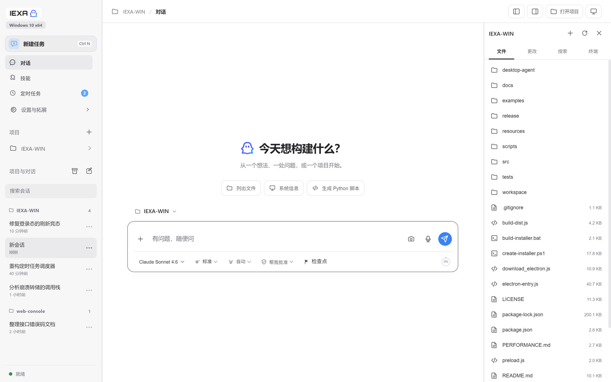
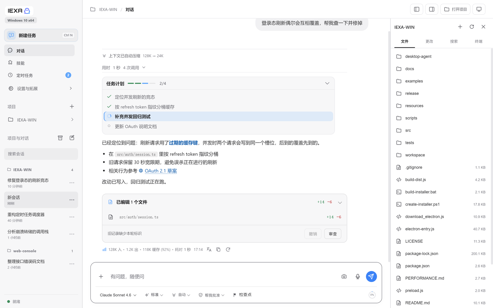
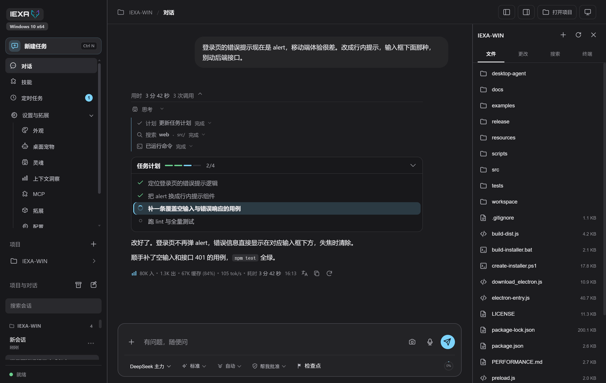
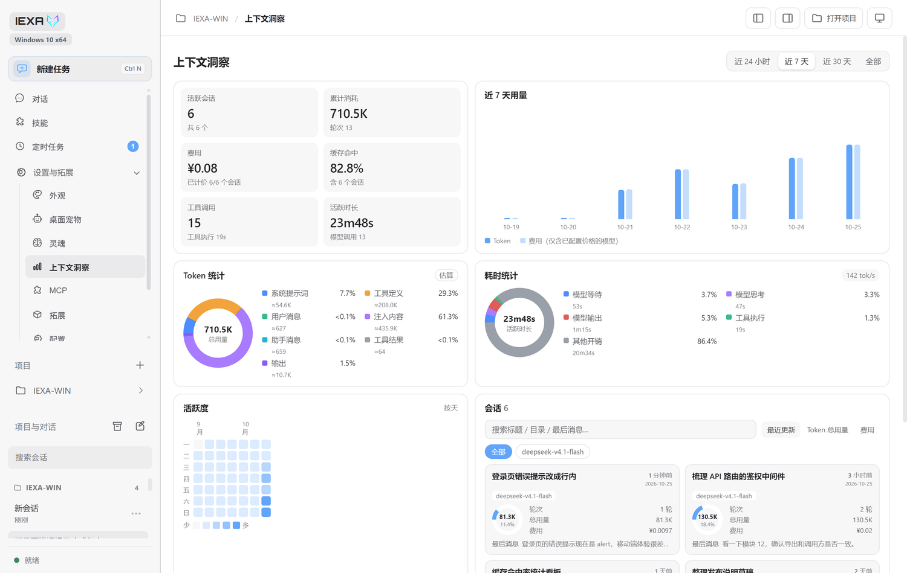
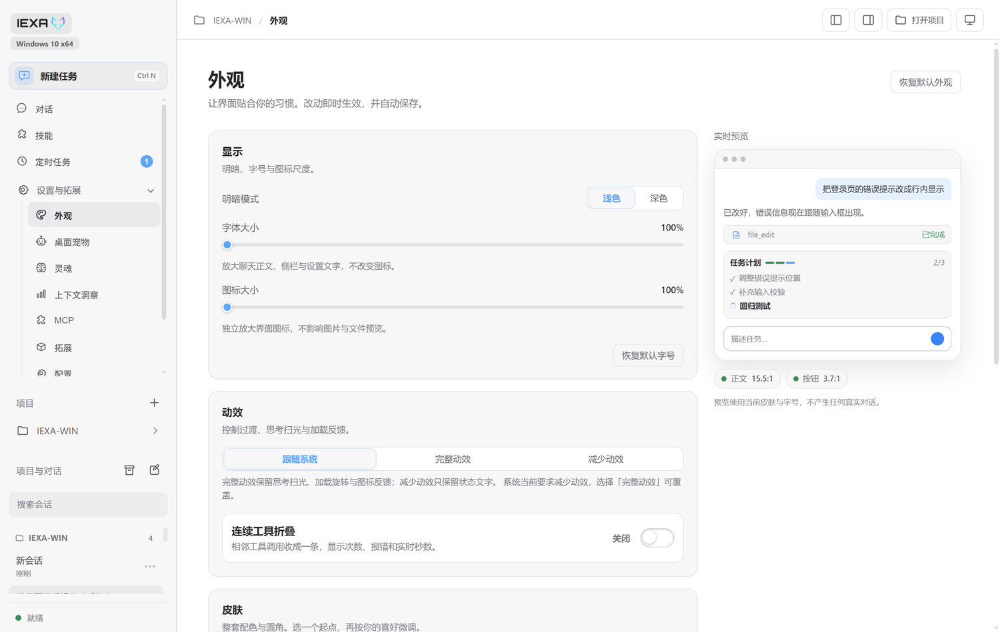
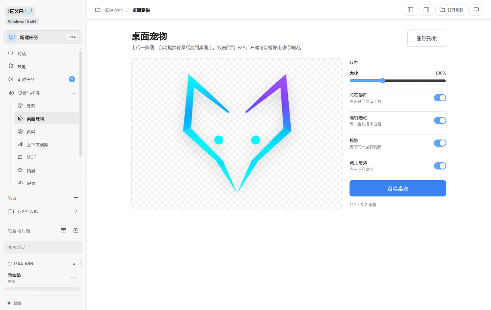
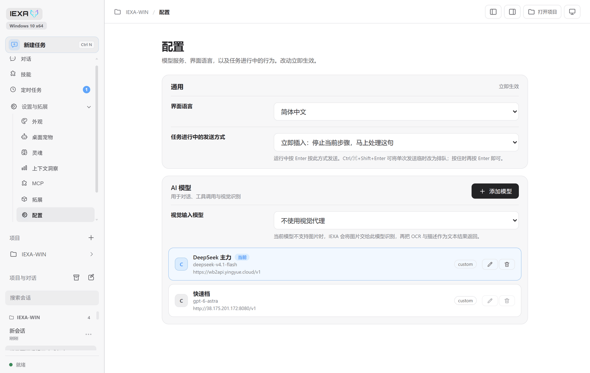

<div align="center">


# IEXA-WIN

**把 AI 代理放进 Windows 桌面。**
模型在云端，手脚在本地：读写文件、执行命令、抓网页、操作桌面，全部在你的机器上完成。

[](#)
[](#)
[](#)
[](#-许可证)

</div>



---

## 它是什么

一个本地优先的 AI 工作台。对话只是入口，真正干活的是它手上的工具：

- **能改代码**：读取、搜索、编辑文件，跑构建和测试，改完告诉你改了什么
- **能跑命令**：PowerShell / CMD / Bash / WSL，输出实时回传
- **能看网页**：抓取页面正文、搜索公开资料，带链接的结果可以直接点开
- **能操作桌面**：通过 Windows UI Automation 点击、输入、读屏
- **能自己排班**：每天 / 每周 / 每月定时执行你写好的提示词

所有能力都在你的机器上执行，密钥存在本地加密库里，不上传第三方服务器。

---

## 界面

<table>
<tr>
<td width="50%"></td>
<td width="50%"></td>
</tr>
<tr>
<td align="center">对话：思考过程、连续工具、任务计划、用量与生成速率</td>
<td align="center">同一段对话的深色主题</td>
</tr>
</table>

<table>
<tr>
<td width="50%"></td>
<td width="50%"></td>
</tr>
<tr>
<td align="center">上下文洞察：Token 构成、耗时分布、用量趋势、活跃度日历</td>
<td align="center">外观：8 套皮肤 + 自定义配色、圆角、字号</td>
</tr>
</table>

<table>
<tr>
<td width="50%"></td>
<td width="50%"></td>
</tr>
<tr>
<td align="center">定时任务：按系统时间自动执行提示词</td>
<td align="center">桌面宠物：一张图，本地抠图，拖到桌面上</td>
</tr>
</table>

<table>
<tr>
<td width="50%" align="center"></td>
</tr>
<tr>
<td align="center">配置：多模型、视觉代理、任务进行中的发送方式</td>
</tr>
</table>

---

## 能做什么

### 对话与代理

| 能力 | 说明 |
|---|---|
| 流式对话 | 思考过程实时展开，工具执行完自动折叠 |
| 思考档位 | 标准 / 高 / 最高等档位，按模型能力自动切换 |
| 工具可视化 | 每一步调用都有输入、输出、耗时和状态 |
| 任务计划 | 模型自己列 TODO，完成一项划掉一项 |
| 上下文压缩 | 压缩时在对话里留下标记，写明压缩前后大小 |
| 暂停与继续 | 停下不丢进度，继续时从原来的步骤接着跑 |
| 重新编辑 | 发错消息可以取回输入框改完重发，替换它之后的内容 |
| 运行中插话 | 任务跑着也能补一句，不必等它结束 |
| 检查点回退 | 回到任意一条消息重新开始 |

### 本地能力

| 工具 | 说明 |
|---|---|
| `shell_execute` | PowerShell / CMD / Bash / WSL，可设超时与工作目录 |
| `file_read` / `file_write` / `file_edit` | 读取、写入、精确替换，自动检测二进制 |
| `grep` / `glob` | 按内容和文件名搜索，支持上下文行 |
| `browser_fetch` / `web_search` | 抓正文、搜公开资料 |
| `desktop_control` | 真实窗口的点击、输入、读屏（Windows UIA） |
| 截图标注 | 框选屏幕，画笔 / 箭头 / 矩形标注后直接发给模型 |
| `memory_*` / Skills / MCP | 跨会话记忆、渐进式技能包、外部工具协议 |

### 工作流

- **定时任务**：每天 / 每周 / 每月，指定模型与会话，到点自动发送提示词；应用未运行时错过的时段会被标记而不是补发。
- **会话管理**：按项目分组、置顶、归档、重命名、全文搜索；支持多窗口独立工作区。
- **上下文洞察**：Token 构成、耗时分布、近 7/30 天趋势、活跃度日历，以及按会话的用量与费用。
- **手机桥接**：扫码配对后用手机打开同一会话，长对话按需分段加载。
- **WebDAV 同步**：NextCloud、ownCloud、NAS 等，同步偏好与会话。

### 界面

- 浅色 / 深色，8 套预设皮肤，也可以自己调配色、圆角和字号
- 中文 / English / 日本語
- 左右面板可拖动、可隐藏，输入框随可用宽度伸缩
- 桌面宠物：上传一张图，本地抠图后放进一个透明置顶小窗
- 输入框支持截图标注、图片预览；消息里的链接在系统浏览器打开

---

## 快速开始

### 方式一：安装包或便携版

从 [Releases](https://github.com/bidalu9-crypto/IEXA-windowns-/releases) 下载任一版本，**不需要预装 Node.js**：

| 文件 | 用法 |
|---|---|
| `IEXA-WIN-Setup-x.y.z.exe` | 安装到本机，带开始菜单与桌面快捷方式，可在「应用和功能」卸载 |
| `IEXA-WIN-Portable-x.y.z.exe` | **单文件便携版**：放到桌面直接双击，不写注册表。数据存在 `%APPDATA%\IEXA-WIN\workspace`，**不会在桌面留文件夹** |

也可以本地构建：

```bat
build-installer.bat
npm run dist:portable
```

产物分别在 `release\IEXA-Setup.exe` 与 `release\IEXA-WIN-Portable-<版本>.exe`。

**让打包版共用已有的会话与配置**

打包版默认把数据放在 `%APPDATA%\IEXA-WIN\workspace`。如果想让 exe 直接读源码目录里那份
`workspace\`（例如从源码用惯了，不想复制几百 MB），新建一个指针文件：

```bat
mkdir "%APPDATA%\IEXA-WIN"
echo E:\IEXA-WIN\workspace> "%APPDATA%\IEXA-WIN\workspace-path.txt"
```

指针里的路径必须以 `\.iexa-sessions.json` 存在为前提，否则会被忽略并回退到默认位置。
指针生效时，源码启动与打包启动共用同一份数据——**两者不要同时打开**，否则两个进程会写同一批
会话文件。

### 方式二：源码运行

前置：**Node.js ≥ 22.13**（推荐 24）、Windows 10 / 11。

```bash
git clone https://github.com/bidalu9-crypto/IEXA-windowns-.git
cd IEXA-windowns-
npm ci
```

然后双击 **`start-electron.bat`**。脚本会自动检查依赖、下载并校验 Electron 运行时、编译 TypeScript，再打开窗口；**窗口出现后控制台会自动隐藏**，关掉 IEXA 时它也随之退出。

想在浏览器里用：

```bash
npm start
```

默认只监听 `127.0.0.1`，并自动打开工作台。

---

## 配置模型

进入 **配置 → AI 模型 → 添加模型**：

| 字段 | 说明 |
|---|---|
| 显示名称 | 自定义，例如「Claude 代码」 |
| 服务商 | Anthropic / OpenAI / Google / DeepSeek / xAI / 自定义 |
| 模型 ID | 例如 `claude-sonnet-4-6`、`gpt-5.1`、`deepseek-chat` |
| API 密钥 | 对应平台的 Key，保存在本地加密库 |
| 接口地址 | 中转站或自建网关填这里，留空则用官方端点 |

- 点「获取模型」可以直接拉取该服务商的可用模型列表。
- 支持配置多个档案，随时切换；每个会话会记住自己用的模型。
- 部分中转站可以在输入框右下角显示账户余额（DeepSeek、OpenRouter、One API / New API 系、WorkBuddy 账号池）。

---

## 安全边界

| 边界 | 做法 |
|---|---|
| 文件访问 | 以工作区和当前项目为根，越界路径直接拒绝 |
| 命令执行 | 默认每次审批；只读模式禁止写操作；完全访问需显式开启 |
| 密钥 | 存操作系统加密库，普通同步不会带出 |
| 插件 | 工具在子进程执行、参数按 JSON Schema 校验；面板跑在 sandbox iframe 里 |
| 网页内容 | Markdown 渲染前净化，模型不能自己开窗口或执行脚本 |
| 桌面自动化 | 独立代理进程，需要 .NET 8 运行时 |

---

## 快捷键

| 快捷键 | 作用 |
|---|---|
| `Ctrl + N` | 新建任务 |
| `Ctrl + K` | 命令面板 |
| `Ctrl + Shift + S` | 截图并标注 |
| `Ctrl + Shift + Enter` | 单次反转「运行中发送」的方式 |
| `Esc` | 关闭面板 / 暂停当前回合 |

---

## 技术栈

| 层 | 选择 |
|---|---|
| 运行时 | Node.js 22.13+ |
| 桌面 | Electron 44（透明窗口、置顶、多实例） |
| 语言 | TypeScript（主进程）/ 原生 JavaScript（渲染层，无框架） |
| 渲染 | 原生 HTML / CSS / JS，无前端框架 |
| Markdown | marked + DOMPurify |
| 代码高亮 | highlight.js |
| 图片处理 | sharp |
| 本地推理 | onnxruntime-web（桌面宠物抠图） |
| 同步 | webdav |
| 测试 | `node --test` + 真实浏览器 / Electron 端到端 |

---

## 开发

```bash
npm run build          # 编译 TypeScript + 校验渲染资源
npm test               # 全量回归（含真实浏览器与 Electron 用例）
npm run dist:builder   # 生成 NSIS 安装包
```

目录概览：

```
src/main/       主进程：Agent 循环、工具、会话、路由、调度
src/renderer/   渲染层：视图、样式、组件
desktop-agent/  Windows 桌面自动化代理（.NET）
resources/      图标、插件宿主、宠物模型
tests/          单元 + 端到端用例
docs/           设计说明与截图
```

---

## 常见问题

**双击 `start-electron.bat` 报 `EPERM: operation not permitted`**
杀毒软件（如火绒、Defender）会在刚解压的 `electron.exe` 上短暂持有句柄，导致目录重命名被拒。安装脚本已内置重试与复制回退，更新到最新版本即可。

**桌面自动化提示不可用**
需要安装 .NET 8 运行时。其余能力（对话、文件、Shell、网页）不受影响。

**截图按钮点了没反应**
Electron 会先弹出画面选择器，选择屏幕或窗口后再框选。

**端口被占用**
多开时会自动分配空闲端口；单实例启动默认 `19840`。

---

## 许可证

[Apache License 2.0](./LICENSE)
